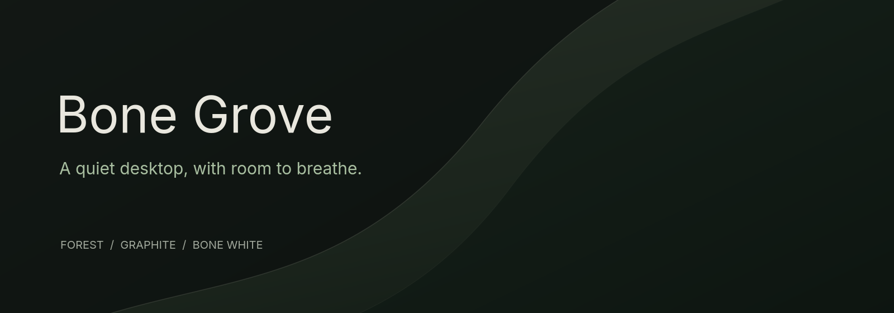
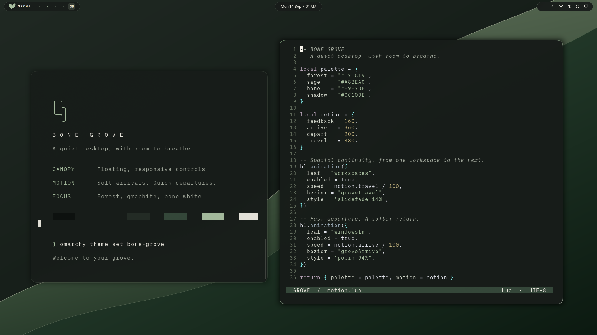
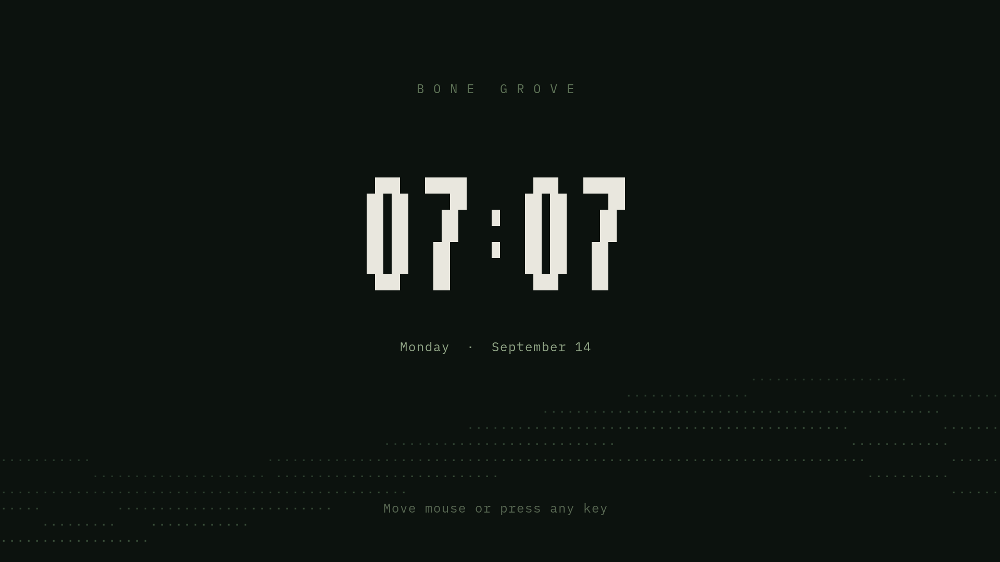

<p align="center"></p>



A dark Omarchy theme in forest, graphite and bone white. Calm contrast, satin surfaces, and motion that follows your attention.



### Install the theme

```bash
omarchy theme install https://github.com/jonahchang207/omarchy-bone-grove-theme
```

This installs the palette, wallpaper, shell surfaces and sage icons. Omarchy generates matching colors for supported terminals, editors and tools. The Canopy bar and custom motion shown above are part of the optional full experience below.

### The full experience

**Requires Omarchy 4 with Lua Hyprland and Quickshell. Tested on Omarchy 4.0.2-1.**

- **Canopy:** three compact floating capsules; Grove mark, sliding workspace rail, central clock and everyday controls, including the monitor control.
- **Motion:** gentle window scaling, shorter departures, smooth resizing, modest workspace travel, coordinated layer and popup fades.
- **Forest clock:** bone-white time and date above slowly moving contour ribbons. Keyboard or mouse input dismisses it.
- **One gesture to quiet it:** middle-click the Grove mark to toggle reduced motion.
- **Native controls:** network, Bluetooth, audio, monitor, power and tray remain Omarchy widgets.

Clone to a separate folder, read the installer, preview its changes, then install:

```bash
git clone https://github.com/jonahchang207/omarchy-bone-grove-theme.git
cd omarchy-bone-grove-theme
python3 install.py --full --dry-run
python3 install.py --full
```

The installer writes only to your home directory. It backs up every path it replaces, including any existing Bone Grove theme, bar layout and screensaver commands. It preserves your idle/lock times and unrelated shell settings. It does not install system packages or change keybindings. A default Omarchy setup already supplies the required terminal and shell dependencies.

The full installer creates a local, editable theme. Re-running it from your separate checkout is how to update the full experience. Omarchy's standard theme installer deliberately regenerates executable theme files, so installing colors alone cannot enable the custom Lua/QML experience automatically.

### Everyday controls

| Action | Result |
| :--- | :--- |
| Click **GROVE** | Open the Omarchy menu |
| Right-click **GROVE** | Preview the screensaver |
| Middle-click **GROVE** | Toggle reduced motion |
| Click a workspace | Switch to it |
| Scroll over workspaces | Switch to the previous or next workspace |
| Click the clock | Open native clock/calendar controls |
| Click a system icon | Open its native panel |

You can also search **Bone Grove Screensaver** in the app launcher, or run:

```bash
bone-grove-motion reduced
bone-grove-motion full
```



The full installer makes Grove the native screensaver: automatic idle activation, `omarchy launch screensaver`, and the direct screensaver command use our renderer. A small user-local CLI shim handles only those screensaver routes and delegates every other command to `/usr/bin/omarchy`. A backed-up Hyprland appearance include gives user-local commands priority when the compositor starts applications. Packaged Omarchy files are untouched.

The screensaver respects your existing idle policy; the session lock remains managed by Omarchy. This is an ambient screensaver, not a replacement lock screen.

### Restore your previous setup

The installer prints a timestamped backup path. Pass that exact path to:

```bash
python3 install.py --restore /path/printed/by/the/installer
```

Restore replaces the installed files with their saved originals. Back up later edits you want to keep before restoring. Screensaver helpers and the Canopy bar persist when you switch color themes; restore the backup to remove the full experience.

### Palette

| Surface | Hex |
| :--- | :--- |
| Forest | `#171C19` |
| Deep shadow | `#0C100E` |
| Raised graphite | `#232B25` |
| Selection | `#35483A` |
| Sage | `#A8BEA0` |
| Bone | `#E9E7DE` |

The wallpaper is original vector artwork rendered at 3840 × 2160; its source is included in `assets/`. No proprietary fonts or artwork are required.

### Scope and compatibility

The full experience controls the desktop compositor, bar, shell surfaces and screensaver. Applications retain control of their internal scrolling and UI animations. GTK apps use their native dark appearance; apps with independent themes may need a separate appearance setting. Older Waybar/Hyprlang-based Omarchy installations can use compatible palette files but cannot run this Quickshell experience.

The bar retains Omarchy's vertical layout fallback; the authored composition is the compact top bar. The optional bar source is derived from Omarchy and may need updates when its shell API changes.

### Validation

```bash
python3 -m unittest discover -s tests -v
omarchy plugin validate experience/plugins/bone-grove.bar
omarchy plugin validate experience/plugins/bone-grove.workspaces
omarchy plugin validate experience/plugins/bone-grove.brand
hyprctl configerrors
```

Installer dry-run and backup/restore tests are included. Live validation covered the top-bar layout and Hyprland configuration. Screensaver checks covered animated frames, small terminals, keyboard dismissal and terminal restoration.

MIT licensed. See [NOTICE.md](NOTICE.md) for attribution. Apple-inspired visual direction, with no Apple or Omarchy affiliation implied.
